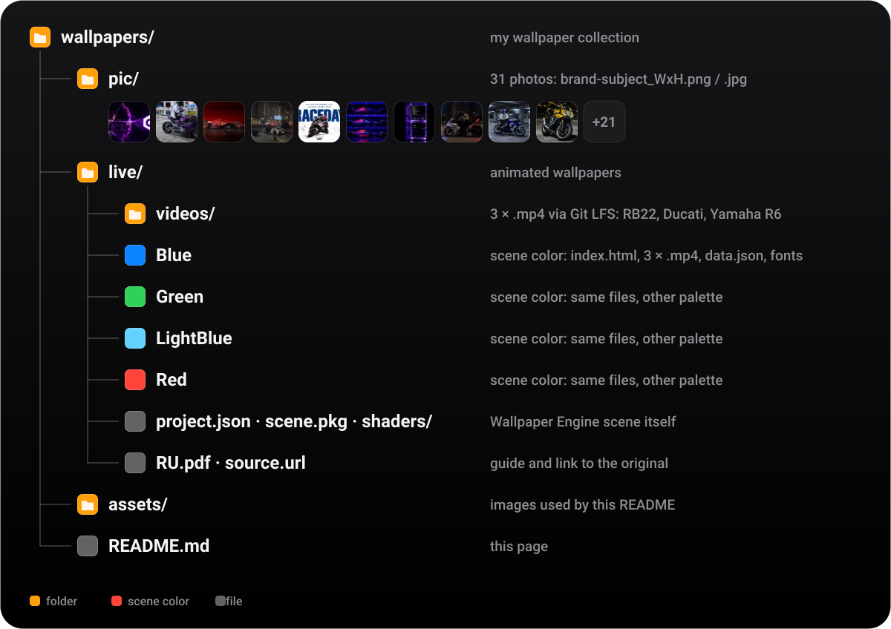

  My personal wallpaper collection: sport bikes, Formula 1, supercars and a few dark portraits. 
  Photos are named by what is on them, with the resolution at the end. Videos live in <code>live/</code>. 

 

 
 

- [`live/videos/`](live/videos) — RB22 (Red Bull F1), Ducati 1199 Panigale 4K, Yamaha YZF-R6 4K. Video files are stored with Git LFS.
- [`live/`](live) — a Wallpaper Engine scene in four colors (Blue, Green, LightBlue, Red) with a clock and a date countdown. Recommended resolution: 1920 × 1080.

 

